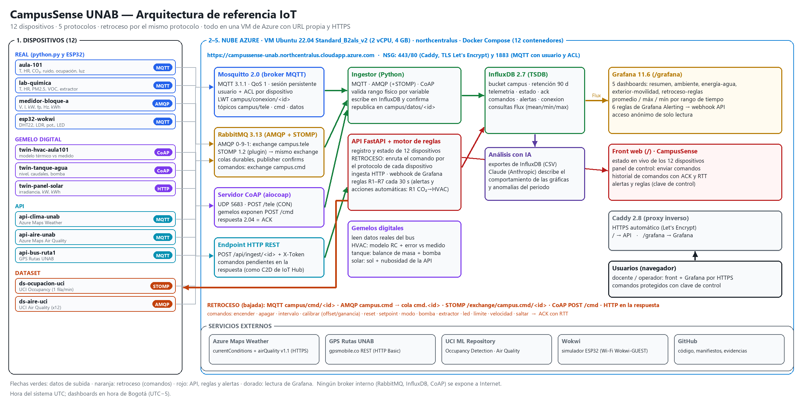

# CampusSense UNAB — IoT a la medida

**Proyecto final (Parcial 2) · IoT + Cloud + Sistemas Distribuidos · Universidad Autónoma de Bucaramanga**

**Integrantes:** Daniel Villamizar · Tomás Urieles · David Guerrero

Plataforma IoT propia para el campus El Jardín de la UNAB (Bucaramanga): **12 dispositivos** de cuatro tipos
(real, gemelo digital, API y dataset) envían datos por **cinco protocolos** (MQTT, AMQP, STOMP, CoAP y HTTP) a una
plataforma desplegada en **Azure** con **URL propia y HTTPS**. Cada dispositivo acepta **comandos de retroceso**
(encender, apagar, cambiar intervalo, calibrar, setpoint, modo…) por su mismo protocolo, y un **motor de reglas**
actúa solo (por ejemplo: CO₂ alto en el aula → el gemelo HVAC pasa a ventilación).

- **Front y API:** https://campussense-unab.northcentralus.cloudapp.azure.com
- **Grafana:** https://campussense-unab.northcentralus.cloudapp.azure.com/grafana (lectura anónima)
- **Documentación de la API (OpenAPI):** https://campussense-unab.northcentralus.cloudapp.azure.com/docs



## Dispositivos

| ID | Tipo | Protocolo | Variables (rango físico aceptado) | Intervalo |
|---|---|---|---|---|
| `aula-101` | Real (python.py) | MQTT | temperatura 10–40 °C, humedad 10–100 %, CO₂ 350–5000 ppm, ruido 25–110 dBA, ocupación 0–60, luz 0–2000 lux | 15 s |
| `lab-quimica` | Real (python.py) | MQTT | temperatura, humedad, PM2.5 0–500 µg/m³, VOC 0–5000 ppb, extractor 0/1 | 20 s |
| `medidor-bloque-a` | Real (python.py) | AMQP | voltaje 100–140 V, corriente 0–600 A, potencia 0–80 kW, fp 0,5–1, frecuencia 59–61 Hz, energía kWh | 30 s |
| `esp32-wokwi` | Real (ESP32 en Wokwi) | MQTT | temperatura y humedad (DHT22), luz (LDR), potenciómetro %, LED | 10 s |
| `twin-hvac-aula101` | Gemelo digital | CoAP | temp. modelo, temp. suministro, setpoint 16–30 °C, potencia 0–10 kW, modo, error del modelo | 30 s |
| `twin-tanque-agua` | Gemelo digital | CoAP | nivel 0–100 %, volumen 0–20 m³, caudal entrada/salida L/min, bomba 0/1, presión bar | 30 s |
| `twin-panel-solar` | Gemelo digital | HTTP | irradiancia 0–1400 W/m², potencia 0–15 kW, temp. panel, energía del día, inversor | 30 s |
| `api-clima-unab` | API (Azure Maps) | MQTT | temperatura, sensación, humedad, punto de rocío, presión, viento, ráfaga, UV, nubosidad, visibilidad, lluvia | 10 min |
| `api-aire-unab` | API (Azure Maps) | MQTT | índice global, PM2.5, PM10, NO₂, O₃, CO, SO₂ | 15 min |
| `api-bus-ruta1` | API (GPS Rutas UNAB) | MQTT | lat, lon, velocidad, encendido, batería externa e interna, distancia al campus | 60 s |
| `ds-ocupacion-uci` | Dataset (UCI 357) | STOMP | temperatura, humedad, luz, CO₂, humedad ratio, ocupación | 60 s |
| `ds-aire-uci` | Dataset (UCI 360) | AMQP | CO, NOx, NO₂, benceno, temperatura, humedad, humedad absoluta | 5 min |

El registro único está en [`plataforma/registro.py`](plataforma/registro.py): lo usan los dispositivos, el ingestor, la API y los dashboards.

## Protocolos: subida y retroceso

| Protocolo | Subida (telemetría, estado, ACK) | Retroceso (comandos) |
|---|---|---|
| MQTT 3.1.1 | `PUBLISH campus/tele/<id>` QoS 1, sesión persistente, LWT `campus/conexion/<id>` | `SUBSCRIBE campus/cmd/<id>` QoS 1 |
| AMQP 0-9-1 | exchange `campus.tele` (topic), routing key `tele.<id>`, publisher confirms | exchange `campus.cmd` (direct) → cola durable `cmd.<id>` |
| STOMP 1.2 | `SEND /exchange/campus.tele/tele.<id>` (plugin STOMP de RabbitMQ) | `SUBSCRIBE /exchange/campus.cmd/<id>` |
| CoAP | `POST` confirmable a `coap://ingestor/tele` | cada gemelo expone `POST /cmd`; la respuesta 2.04 es el ACK |
| HTTP REST | `POST /api/ingest/<id>` con `X-Token` | los comandos pendientes viajan en la respuesta (como C2D de IoT Hub) |

Comandos comunes: `encender`, `apagar`, `intervalo`, `calibrar` (offset y ganancia por variable), `reset`.
Propios: `setpoint` y `modo` (HVAC), `bomba` y `consumo` (tanque), `limite` (solar), `extractor` (laboratorio), `led` (ESP32),
`velocidad` y `saltar` (datasets). Cada comando se registra en InfluxDB y el dispositivo responde con un ACK que trae el tiempo de ida y vuelta.

```bash
curl -X POST https://campussense-unab.northcentralus.cloudapp.azure.com/api/dispositivos/twin-hvac-aula101/comando \
  -H "X-Clave: <clave de control>" -H "Content-Type: application/json" \
  -d '{"accion": "setpoint", "params": {"valor": 22}}'
```

## Procesamiento, reglas y visualización

- **Ingestor:** valida el rango físico de cada variable, escribe en InfluxDB y republica en `campus/datos/<id>` (bus interno del que leen los gemelos y la API).
- **Motor de reglas (API, cada 30 s):** R1 CO₂ > 1000 ppm → HVAC en ventilación · R2 demanda > 30 kW → HVAC en eco · R3 tanque < 20 % · R4 PM2.5 laboratorio > 35 µg/m³ · R5 calidad del aire exterior · R6 dispositivo sin datos · R7 velocidad del bus > 60 km/h.
- **Grafana:** 5 dashboards (resumen, ambiente, energía y agua, exterior y movilidad, retroceso y reglas) con mínimo, promedio y máximo del rango elegido, y 6 reglas de Grafana Alerting que avisan a la API por webhook.

## Estructura

```
docker-compose.yml        12 contenedores: brokers, InfluxDB, ingestor, API, 4 de dispositivos, Grafana, Caddy
plataforma/               código Python (una imagen): registro, biblioteca común, dispositivos, ingestor, API, front
  registro.py             los 12 dispositivos, variables, rangos y comandos
  comun.py                clase base de dispositivo + enlaces MQTT/AMQP/STOMP/CoAP/HTTP + bus de datos
  dispositivos_reales.py  aula-101, lab-quimica, medidor-bloque-a
  gemelos.py              HVAC, tanque, planta solar
  apis.py                 Azure Maps (clima, aire) y GPS del bus
  datasets.py             repetición de los datasets UCI
  ingestor.py, tsdb.py    ingesta de 4 protocolos y escritura en InfluxDB
  api.py, static/         back-end FastAPI, motor de reglas y front web
wokwi/                    firmware ESP32 (PlatformIO) + diagrama Wokwi + script de simulación
datasets/                 CSV limpios de UCI y su procedencia
grafana/                  generadores de dashboards y alertas, aprovisionamiento
caddy/, mosquitto/, rabbitmq/   configuración de la entrada HTTPS y los brokers
informe/                  generadores del diagrama y del informe
evidencias/, mediciones/  capturas y salidas reales
```

## Cómo desplegar

```bash
# en una VM Linux con Docker (en Azure: abrir 80, 443 y 1883 en el NSG y poner una etiqueta DNS a la IP pública)
git clone https://github.com/Daniverd15/CampusSense-IoT.git && cd CampusSense-IoT
cp .env.example .env          # cambiar TODAS las claves y poner el dominio
docker compose up -d --build
docker compose ps             # 12 contenedores Up / healthy
```

ESP32 en Wokwi: `MQTT_USER=esp32 MQTT_PASS=<clave> WOKWI_CLI_TOKEN=<token> ./wokwi/build_y_simular.sh 600`.

## Seguridad

- Sin secretos en el repositorio: todas las claves van en `.env` (ignorado por git); `.env.example` solo trae marcadores.
- Hacia Internet solo quedan 443/80 (Caddy con HTTPS) y 1883 (MQTT con usuario y ACL: el usuario del ESP32 solo puede publicar en sus tópicos).
- RabbitMQ, InfluxDB y CoAP solo escuchan dentro de la red de Docker. Enviar comandos exige la clave de control.
- Del GPS del bus solo se guardan posición, velocidad y baterías (no nombres de conductores ni datos de la SIM).

## Créditos de datos

- Azure Maps Weather (Microsoft) — clave entregada por el docente.
- Candanedo, L. & Feldheim, V. (2016). *Occupancy Detection* [Dataset]. UCI Machine Learning Repository. https://doi.org/10.24432/C5X01N
- Vito, S. (2008). *Air Quality* [Dataset]. UCI Machine Learning Repository. https://doi.org/10.24432/C59K5F
