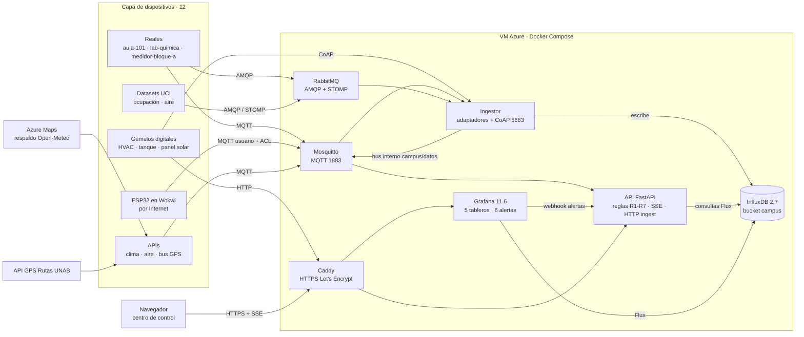
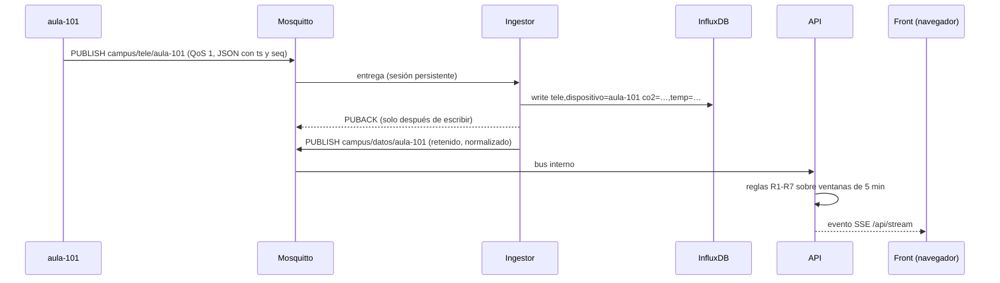
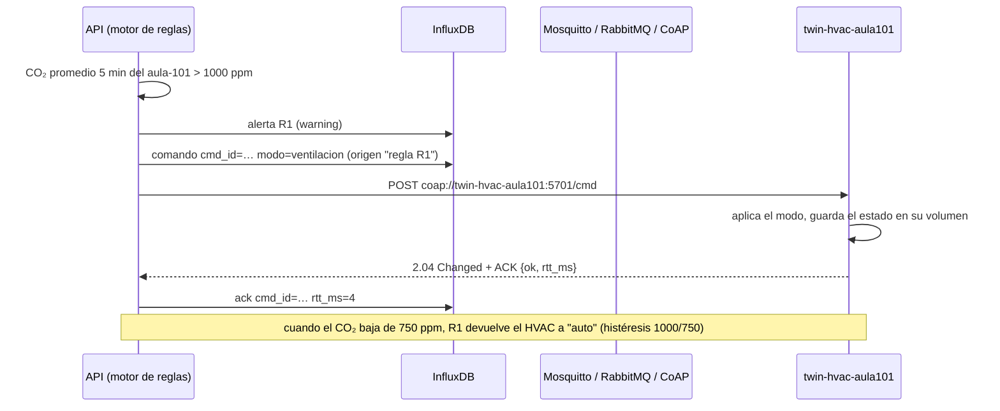

# Arquitectura de CampusSense UNAB

Todo corre en **una VM de Azure** (`Standard_B2als_v2`, 2 vCPU / 4 GB, North Central US) con Docker Compose.
Hacia Internet solo salen 443/80 (Caddy con HTTPS) y 1883 (MQTT con usuario y ACL); el resto vive en la red interna de Docker.
La figura del informe (`evidencias/00-arquitectura.png`) es la versión gráfica de este documento.

## 1. Vista general

| Capa | Componentes | Qué hace |
|---|---|---|
| Dispositivos | 4 reales (uno es el ESP32 en Wokwi), 3 gemelos, 3 APIs, 2 datasets | Miden o simulan, publican por su protocolo y obedecen comandos |
| Conectividad | Mosquitto 2.0, RabbitMQ 3.13 (AMQP 0-9-1 + plugin STOMP), servidor CoAP, endpoint HTTP | Reciben la subida y entregan la bajada (retroceso) |
| Ingesta | `ingestor` (un adaptador por protocolo) | Valida el JSON, lo escribe en InfluxDB y lo republica normalizado en `campus/datos/<id>` (retenido) |
| Datos | InfluxDB 2.7 | Series de tiempo: `tele`, `estado`, `comandos`, `acks`, `alertas` |
| Aplicación | API FastAPI | Registro, comandos con ACK, motor de reglas R1-R7, resúmenes (prom/máx/mín), SSE en vivo |
| Visualización | Grafana 11.6 + front propio | Tableros con rango fijo de la toma; centro de control en tiempo real |
| Borde | Caddy 2.8 | HTTPS automático, `/` → API y front, `/grafana` → Grafana |

## 2. Subida de un dato (ejemplo: Aula 101 por MQTT)

## 3. Retroceso y lazo automático (regla R1)

Cada protocolo baja por su propio canal:

| Protocolo | Subida | Bajada | RTT mediano del ACK |
|---|---|---|---|
| MQTT | `campus/tele/<id>` QoS 1 | `campus/cmd/<id>` QoS 1 | 1 ms (81 ms el ESP32 por Internet) |
| AMQP | exchange `campus.tele`, clave `tele.<id>` | exchange `campus.cmd` → cola `cmd.<id>` | 7,5 ms |
| STOMP | `/exchange/campus.tele/tele.<id>` | `/exchange/campus.cmd/<id>` | 6 ms |
| CoAP | `POST CON coap://ingestor/tele` | el gemelo es servidor: `POST /cmd` | 4 ms |
| HTTP | `POST /api/ingest/<id>` con token | los comandos vuelven en la respuesta del siguiente envío | 27,9 s (= intervalo de envío) |

## 4. Decisiones de diseño

| Decisión | Alternativa | Por qué |
|---|---|---|
| Una VM con Docker Compose | AKS (como en el Lab 6) | El Lab 6 mostró que AKS consume rápido los créditos de estudiante y choca con los límites de cuota; para 12 dispositivos una VM de 4 GB sobra (≈ US$0,9/día) y se replica con un `docker compose up` |
| InfluxDB 2.7 | PostgreSQL / TimescaleDB | Es una base de series de tiempo nativa: `aggregateWindow` da promedios, máximos y mínimos por ventana sin SQL extra, y Grafana la consulta directo |
| Mosquitto + RabbitMQ | Un solo broker para todo | Cada protocolo con su broker de referencia; RabbitMQ cubre AMQP y STOMP con el mismo intercambio, así hay 5 protocolos con 2 brokers |
| Bus interno `campus/datos/<id>` retenido | Que la API lea cada broker | Los 5 protocolos se normalizan en un único formato; la API y el front no saben de protocolos y un cliente nuevo recibe el último valor al conectarse |
| ACK de vuelta con `cmd_id` | Comandos "dispara y olvida" | El retroceso se puede demostrar y medir (RTT por protocolo) y la interfaz muestra si el equipo obedeció |
| HTTP con comandos en la respuesta | Que la plataforma llame al dispositivo | Un equipo HTTP real suele estar detrás de NAT; aprovechar su propio envío evita abrir puertos en el campo (a cambio, la latencia es el intervalo de envío) |
| Gemelos CoAP como servidores | CoAP solo de subida | CoAP es petición/respuesta: el gemelo expone `/cmd` y responde el ACK en la misma transacción confirmable |
| Reglas en la API **y** alertas en Grafana | Solo Grafana | Las reglas que actúan (R1, R2) necesitan mandar comandos con memoria e histéresis; Grafana Alerting queda como segunda capa visual y avisa a la API por webhook |
| Caddy | Nginx + certbot | HTTPS automático y renovación sin tareas programadas, con pocas líneas de configuración |
| ESP32 en Wokwi | Hardware físico | El enunciado permite simular; el firmware es C++ real (PlatformIO) y se conecta por Internet al mismo broker, con usuario propio y ACL |
| Respaldo Open-Meteo | Depender solo de Azure Maps | El 15-nov la cuenta de Azure Maps quedó bloqueada (`401 AccountLocked`); los dispositivos pasan solos a Open-Meteo y siguen reintentando la fuente principal cada 6 h |
| Rango fijo en Grafana e informe | "Últimos 6 días" | La toma oficial (8-nov 23:19 → 14-nov 23:19) se puede volver a ver idéntica el día de la sustentación |

## 5. Seguridad

- Puertos públicos: 22 (SSH con llave), 80 (solo redirige), 443 y 1883. RabbitMQ, STOMP, InfluxDB, CoAP, Grafana y la API directa no son alcanzables desde Internet (comprobado en `mediciones/prueba_humo_17nov.txt`).
- MQTT sin acceso anónimo. El usuario del ESP32 solo puede publicar en `campus/tele/esp32-wokwi` y `campus/conexion/esp32-wokwi` y leer `campus/cmd/esp32-wokwi`: suscrito a `campus/#` no recibe nada y no puede suplantar a otro equipo.
- Comandos con clave (`X-Clave`), ingesta HTTP con token y webhook de Grafana con `Authorization: Bearer` (el token no viaja en la URL ni queda en los logs); Grafana anónimo es solo lectura.
- Mínimo privilegio en los datos: Grafana usa un token de InfluxDB de solo lectura del bucket `campus` (escribir o borrar → 403); el token de administrador solo existe en los contenedores internos.
- Resiliencia ante reinicio de la VM: Docker arranca con el sistema y todos los contenedores tienen `restart: unless-stopped`; medido: HTTPS a los 38 s y los 11 dispositivos con datos nuevos a los 47 s, con su estado y la memoria de las reglas intactos.
- Claves en `.env` (no versionado); `.env.example` trae marcadores.
- Limitación conocida: MQTT en 1883 va sin TLS (se dejó así para simplificar el firmware simulado); en producción se usaría 8883 con TLS y un certificado por equipo.
